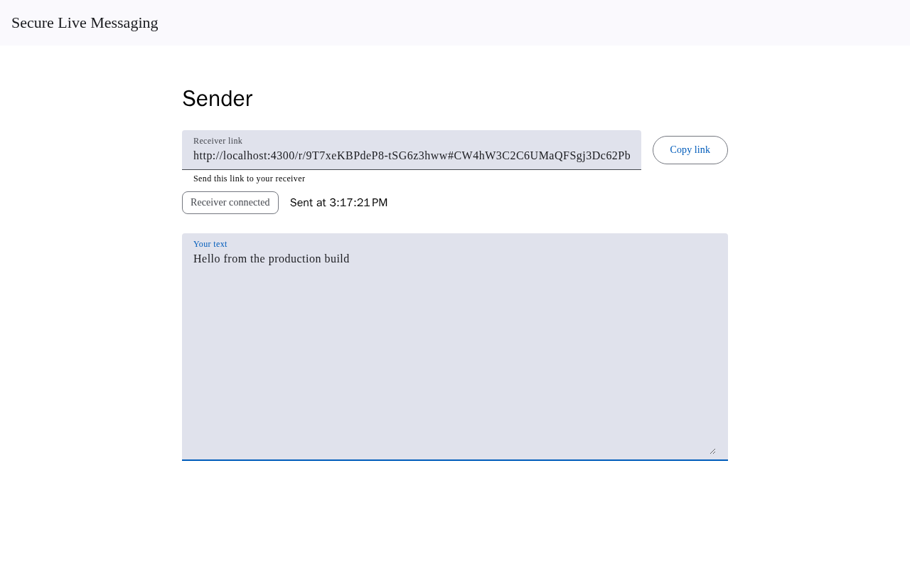
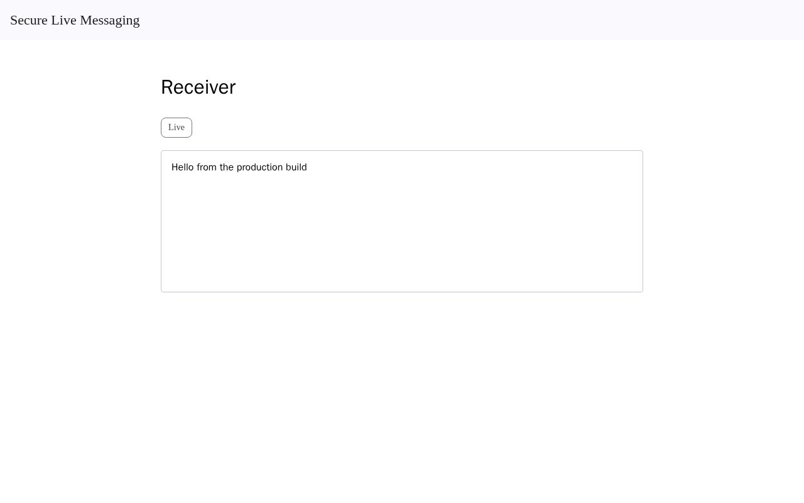
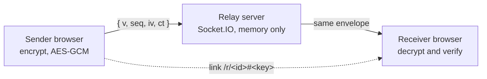

# Secure Live Messaging

Share live-updating text with one receiver through a link, end-to-end encrypted in the browser.

## How it works

**Sender:** types the text and copies the receiver link.



**Receiver:** opens the link and sees the text update live.



- The sender opens the app, starts a session and gets a receiver link: `/r/<id>#<key>`.
- The sender passes the link to the receiver outside the app.
- Each change to the text is encrypted in the sender's browser (AES-GCM-256) and sent through the server.
- The receiver's browser decrypts it with the key from the link and shows it live; a tampered, replayed or undecryptable update keeps the last good text and shows a warning.
- The key sits after the `#`, which browsers never send, so the server relays only ciphertext and never sees the key or the text.

## How to run the app

### Prerequisites

- **Node 24 LTS** (`.nvmrc`). The repo sets `engine-strict=true`, so `npm ci` fails on purpose on any other major. The npm scripts set no variables through shell syntax, so they run the same on macOS, Linux and Windows.
- Or **Docker with Compose v2**, with no Node on the host at all.

Open the app at `http://localhost:<port>`, never a LAN IP: WebCrypto works only on `https` or `localhost`.

### Install

```bash
npm ci
```

### Docker only (no Node needed)

```bash
docker compose up --build
```

Builds the client into the image and starts the server in production mode. Open `http://localhost:4200`. The port is published on `127.0.0.1` only; set `CLIENT_PORT=4310` to use another host port. Stop with `Ctrl+C`, then `docker compose down`.

`docs/dev-environment.md` covers the `dev` container, which runs every command below without Node on the host: `docker compose run --rm dev <command>`.

### Development mode

```bash
npm run dev
```

Starts the Socket.IO server on `127.0.0.1:3000` and the Angular dev server on `http://localhost:4200`, which proxies `/socket.io` to the server and reloads on edits. The dev server does not send the security headers listed in [`docs/details.md`](docs/details.md#security-headers-production-mode).

### Production mode

```bash
npm start
```

Builds the client (`npm run build`), then starts the server in production mode (`--production`). The server serves the built app and the Socket.IO relay from one origin at `http://localhost:3000`, with the security headers. Any path that is not a built file, such as `/s/<id>` or `/r/<id>`, returns the app's index page.

### Ports and settings

| Setting | Default | What it does |
|---|---|---|
| `PORT` | `3000` | Server port. The dev proxy follows it. |
| `HOST` | `127.0.0.1` | Address the server binds. The Docker image sets `0.0.0.0` inside the container; compose still publishes only on `127.0.0.1`. |
| `ALLOWED_ORIGINS` | Development: `http://localhost:4200,http://127.0.0.1:4200`. Production: unset, which means same origin only. | Comma-separated origins allowed to open the WebSocket. Never `*`. |
| `NODE_ENV` | unset | `production` (set by the Docker image) serves the built client from `client/dist/client/browser`, as `npm start` does with its `--production` argument. |
| `CLIENT_PORT` | `4200` | Docker only: the host port compose publishes. |

The app does not terminate TLS and does not send `Strict-Transport-Security`. Put it behind a reverse proxy that terminates HTTPS and sets HSTS when it runs anywhere but `localhost`.

## Architecture and key decisions



- **Untrusted relay:** a fresh random IV per message, with the session id and seq bound as authenticated data. The server keeps only the latest ciphertext, in memory.
- **Node + TypeScript + Socket.IO, WebSocket only.** The session rules are a pure module; the socket handlers are a thin shell around it.
- **Angular 21 + Material:** standalone components, signals, zoneless change detection.
- **Sender token:** anyone with the link has the key, so publishing also needs a server-issued token kept in the sender tab. A receiver rejoin token lets a reconnecting receiver take its slot back.
- **npm workspaces `shared/`, `server/`, `client/`:** protocol types, validators and the crypto envelope live once, in `shared/`.

## Security assumptions

- The server sees session ids, message sizes and timing, and IP addresses. It never sees the key or the text.
- It cannot alter, move or replay an update unnoticed: the receiver accepts one only if it decrypts **and** its seq is higher than the last one accepted.
- Someone holding only the receiver link can read the text, but cannot publish or take over the session.
- **A malicious server could serve modified JavaScript that leaks the key. Nothing in the app can detect that.**
- The production server sends a strict CSP, `Referrer-Policy: no-referrer` and `nosniff`. HTTPS is left to a reverse proxy.

## Tests

```bash
npm test           # Vitest: unit (crypto, validators, session core, receiver state) and integration (real server on a random port)
npm run e2e        # Playwright: two browsers, consecutive updates, wrong and truncated keys, no key or text on the wire
npm run typecheck
```

Run `npx playwright install chromium` once before the first `npm run e2e`.

## Known limitations

- The key stays in browser history and wherever the link is pasted. Next step: strip the fragment after the key is imported.
- The receiver cannot verify who wrote the text. Next step: the sender signs each update.
- Sessions are in memory, so a restart ends them all.
- Message timing and size are visible to the server. Next step: pad envelopes to fixed sizes.

## AI usage

### Models and tools
- **Claude Code**, the coding assistant in the terminal, with **Claude Opus 5.5**: implementing the tasks, writing the unit, integration and end-to-end tests, driving the headless browser checks and screenshots, writing the test guides, and opening the pull requests.
- **Claude Code with Claude Fable 5.2**: the project documentation, the task files and the skills.

### Skills
The repo ships three skills in `.claude/skills/`:
- **Task intake** (`secure-live-messaging-task-intake`): a structured intake (type, role, surface, goal, security impact, tests) that turned `docs/implementation-plan.md` into the task files in `docs/tasks/`, each with desired behaviour, acceptance criteria, security considerations and out-of-scope items, plus the schedule in `docs/tasks/README.md`.
- **Task implementation** (`secure-live-messaging-task-implementation`): takes one task to a pull request: preflight checks, a branch per task, a plan approved in plan mode that maps every acceptance criterion to code and a test, implementation, tests, a headless browser check with screenshots, a test guide in `docs/guides/`, implementation notes in the task file, then a commit and a pull request.
- **Test gaps** (`secure-live-messaging-test-gaps`): finds pure functions in a diff that lack unit tests or the negative test a security rule needs.

### One useful AI contribution
In the client session services, the assistant checked the `socket.io-client` source and found that an emit made while the socket is disconnected is buffered and sent right after the reconnect, before the sender has rejoined with its token. The socket wrapper in `client/src/app/session/session-socket.ts` now fails such an emit at once instead, and a test covers it, so a publish can never reach the server ahead of the rejoin.

### One thing independently verified or corrected
Serving the production build, the unit tests and the build passed, but the end-to-end test that opens a receiver link directly failed: the receiver never joined. The browser console showed that the CSP's `base-uri 'none'` blocks Angular's default `<base href="/">`, so on `/r/<id>` the relative script and style URLs resolved under `/r/` and came back as the HTML fallback, which `nosniff` refused to run. The CSP stayed as specified; the production build now has no `<base>` element and uses absolute asset paths, the router gets its base from `APP_BASE_HREF`, and a spec guards both. The CSP check itself was then proven able to fail by planting an inline script in the built page: the test reported the `script-src-elem` violation.

Each task file in `docs/tasks/` ends with implementation notes that record more of these checks, including faults planted on purpose to prove that the tests catch them.

## More

The full decision table, the security headers, test coverage per level and every known limitation: [`docs/details.md`](docs/details.md). Design reasoning: [`docs/architecture-decisions.md`](docs/architecture-decisions.md).
