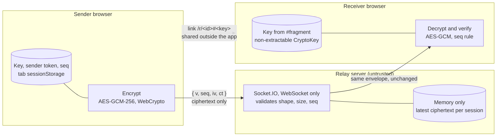

# Secure Live Messaging: details

## What it is

A sender types into a text box and one receiver, who has opened a link from the sender, sees that text appear and update live. The text is encrypted in the sender's browser with AES-GCM and decrypted in the receiver's browser. The key travels only inside the link, after the `#`, which browsers never send to a server. The Node server in between relays ciphertext over WebSocket and never has the key or the readable text. Text flows one way, and a session has exactly one sender and one receiver.

How to run the app, with and without Docker: [README](../README.md#how-to-run-the-app).

## Architecture and key technical decisions

What travels over the wire is the session id, the sender token or receiver rejoin token, and envelopes `{ v: 1, seq, iv, ct }`. The key and the plaintext never do. The server keeps only a SHA-256 hash of each token.

| Decision | Summary | Main rejected alternative |
|---|---|---|
| **D1** Untrusted ciphertext relay | The key lives in the receiver link's fragment. AES-GCM-256 with a fresh random 12-byte IV per message, and `slm:v1\|<sessionId>\|<seq>` bound as authenticated data. The server holds only the latest ciphertext, in memory. | Server-side encryption or key handling, which would let the operator read the text. |
| **D2** Node + TypeScript + Socket.IO, WebSocket only | Reconnection, acknowledgements and rooms built in. No long-polling surface. Session rules are a pure module; socket handlers are a thin shell. | Plain `ws`, which would need reconnection and acks written by hand. |
| **D3** Angular LTS + Angular Material | Standalone components, signals, zoneless change detection. | A fixed requirement. |
| **D4** Project docs in `docs/` | Decisions, plan and one file per task. | Docs spread through the code. |
| **D5** Server-issued sender token | Anyone with the link has the key, so the key must not be enough to publish. Creating a session returns a token kept in the sender tab; publishing requires it, compared in constant time. | A signing keypair in the link: stronger, but more crypto than this scope needs. |
| **D6** npm workspaces `shared/`, `server/`, `client/` | Protocol types, validators and the crypto envelope live once in `shared/`, so the two sides can't drift. | Separate repos or copied types. |
| **D7** Vitest everywhere + Playwright | Pure cores tested directly, the server through real sockets, the flow in two real browsers. | Mocked crypto or a single-browser end-to-end test. |
| **D8** Receiver rejoin token | A reconnecting receiver takes its slot back at once; someone with only the link cannot kick it out. | Waiting up to about 45 seconds for the server to notice the dead socket. |

Details and reasoning: [`docs/architecture-decisions.md`](architecture-decisions.md). Flow, protocol and crypto: [`docs/implementation-plan.md`](implementation-plan.md).

## Security assumptions and considerations (threat model)

### What the server can see
- Session ids, and which socket is sender or receiver.
- The size and timing of every encrypted update.
- IP addresses, and when each side connects and disconnects.

### What the server cannot see or do
- It never has the key or the plaintext. The key sits in the URL fragment, which the browser never sends, and the sender keeps it in tab storage.
- It cannot alter a message, move it to another session or replay it without the receiver noticing. AES-GCM authenticates the ciphertext together with the session id and seq, and the receiver accepts an update only if decryption succeeds **and** its seq is higher than the last accepted one. A rejected update keeps the last good text and shows an integrity warning.
- A receiver-link holder cannot publish: publishing needs the sender token, which never goes into a link.

### What a malicious or compromised server could still do
- **Serve modified JavaScript that reads the key from the fragment and sends it away. This defeats the encryption completely.** The browser trusts whatever code the origin serves; nothing in this app can detect that.
- Drop, delay or reorder updates, or refuse service. The receiver would see stale text, not wrong text.
- Forge valid ciphertext if it also learns the key, for example from a leaked link.

### What the receiver link holder can do
- Read the text: the link carries the key. Anyone the link is forwarded to can read it too.
- Not publish, not take over the sender, and not take an occupied receiver slot without the receiver's rejoin token.

### Security headers (production mode)

Every response from the production server (index page, static files, fallback routes, refused methods) carries these headers. The index page also gets `Cache-Control: no-store`, so a stale page is never run against a newer server.

| Header | Value | Defends against |
|---|---|---|
| `Content-Security-Policy` | `default-src 'none'` | Anything not explicitly allowed below. |
| | `script-src 'self'` | Injected inline scripts and `eval`. A second line of defence behind plain-text rendering, never a replacement for it. |
| | `connect-src 'self'` | Injected or modified code opening a socket or request to another host, which narrows key exfiltration paths. |
| | `style-src 'self' 'unsafe-inline'` | Third-party stylesheets. Inline styles are allowed because Angular and Material inject component styles at runtime; styles cannot run code. |
| | `img-src 'self' data:`, `font-src 'self'` | Loading images and fonts from other hosts. The app uses system fonts and no icon font. |
| | `base-uri 'none'` | An injected `<base>` element redirecting relative URLs. The built app therefore has no `<base>` and uses absolute asset paths. |
| | `form-action 'none'`, `object-src 'none'` | Form submission to another host, and plugins. |
| | `frame-ancestors 'none'` | Another site framing the sender or receiver page for clickjacking. |
| `Referrer-Policy` | `no-referrer` | The session path leaking to another site in the `Referer` header. |
| `X-Content-Type-Options` | `nosniff` | A response being run as a script or stylesheet when its declared type says otherwise. |

## Tests and how to run them

| Level | What it covers | Command |
|---|---|---|
| Unit (Vitest) | `shared/`: the crypto envelope (tampered ciphertext, IV or AAD rejected, fresh IVs, strict base64url) and the protocol validators. `server/`: the pure session core (role slots, tokens, seq rule, expiry), rate limiter, origin policy, the security headers and static routing. `client/`: the pure receiver reducer, the sender pipeline with fake timers, the pages, plain-text rendering. | `npm test` |
| Integration (Vitest) | The real Socket.IO server on a random port with `socket.io-client`: the full flow with consecutive updates, late joiners, forged and oversized publishes, origin checks, reconnects. The header check: the production server against a fixture build, asserting the exact headers on the index page, a script asset and a receiver route. | `npm test` |
| End-to-end (Playwright) | Two browser contexts with real WebCrypto. Against the dev stack: two consecutive updates without a reload, a truncated and a wrong key, and that neither the key nor the plaintext appears in any request or WebSocket frame. Against the production build: the full flow with the receiver link opened directly, no CSP violation in either browser, and no request to another host. | `npm run e2e` |
| Type check | Strict TypeScript in every workspace. | `npm run typecheck` |

`npm run e2e` builds the client, then starts the dev stack on port 4200 and the production server on port 4300 by itself. On a host, run `npx playwright install chromium` once before the first run. With Docker: `docker compose build dev`, `docker compose run --rm dev npm ci`, then `docker compose run --rm dev npm test` (or `npm run typecheck`, `npm run e2e`); the dev image ships Chromium.

## Known limitations and what would be improved with more time

| Limitation | Improvement |
|---|---|
| The key is in the receiver link, so it ends up in browser history and wherever the link is pasted. | Strip the fragment with `history.replaceState` after the key is imported, keeping it in tab storage for a reload. |
| The operator sees metadata: timing, message sizes, IP addresses. | Pad envelopes to fixed size buckets and send on a fixed cadence; IP addresses would need an anonymising network. |
| A malicious server can serve modified JavaScript that leaks the key. | Serve the client from a separately controlled origin with a signed, reproducible build, or ship it as an installable app; SRI alone does not help while the same server serves the HTML. |
| The sender token proves only who may publish to the server. The receiver cannot verify authorship. | A signing keypair: the sender signs envelopes and the receiver verifies them with a public key from the link. |
| Everything is in memory; a server restart ends all sessions. | Keep the latest ciphertext and token hashes in a store with a TTL, such as Redis. |
| A link whose key was altered but still decodes to 32 bytes imports cleanly and joins, taking the receiver slot. Every update then shows the integrity warning instead of the key error. | A key-check value in the protocol, so a wrong key is detected before joining. |
| `style-src` allows `'unsafe-inline'` because Angular and Material inject styles at runtime. | A nonce-based style policy (Angular's `ngCspNonce`). |
| The CSP does not enforce Trusted Types; it is unverified with Angular Material. | Add `require-trusted-types-for 'script'` once the app is checked under it. |
| The production server runs the TypeScript source through `tsx` and keeps the built client in memory. | Compile the server to JavaScript for a smaller runtime image without dev dependencies. |
| Only production mode sends the security headers; the Angular dev server is not hardened. | Mirror the headers in the dev server configuration. |
| HTTPS and HSTS are left to a reverse proxy. | Ship a proxy configuration with TLS and HSTS for deployment. |
