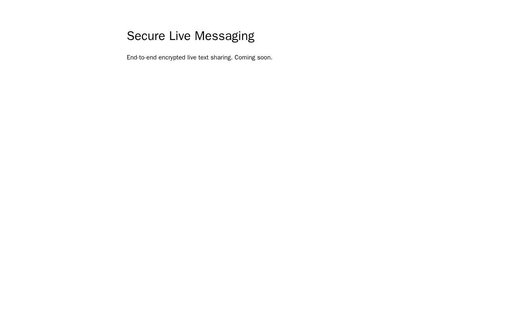

# Test guide: 00 Set up the workspaces, test runners, WebSocket dev proxy and a Docker setup to run the app

## What this covers
The repo scaffold: npm workspaces `shared`, `server` and `client`, the four root commands (`dev`, `test`, `typecheck`, `e2e`), the WebSocket-only Socket.IO server behind the Angular dev proxy, the Node 24 pin, and the Docker `app` and `dev` services. It verifies every acceptance criterion of `docs/tasks/00-project-scaffold.md`.

## Before you start
- Either Node 24 LTS on the host (`nvm use` reads `.nvmrc`), or only Docker. All steps below were run through Docker, because the host had another Node major.
- With Docker, build the dev image and install once:
  ```sh
  docker compose run --rm dev npm ci
  ```
  With Node 24 on the host, run `npm ci`.
- Start the app with `docker compose up --build` (the `app` service) or `npm run dev` on the host. Both serve `http://localhost:4200`.
- Several checkouts on one machine: set `COMPOSE_PROJECT_NAME` per checkout so volumes and containers don't collide, and `CLIENT_PORT` to publish the client on another host port.
- When this guide was written, another checkout held port 4200, so the host steps ran with `CLIENT_PORT=4310` and `http://localhost:4310`. Inside the containers the ports are 4200 and 3000 as described. Steps 3, 6 and 7 ran inside the `dev` container (`docker compose run --rm dev`), with the same `npm run dev` command and mounted source that `docker compose up dev` uses.
- `docker compose up dev` publishes the client port (`4200/tcp -> 127.0.0.1:4200`); `docker compose run --rm dev …` publishes none, so test runs from several checkouts don't clash.

## Automated tests
Run in the `dev` service (or the same commands on a Node 24 host without the `docker compose run --rm dev` prefix):

| Command | Result |
|---|---|
| `docker compose run --rm dev npm test` | shared 1 test, server 14 tests, client 4 tests; all passing, exit code 0 |
| `docker compose run --rm dev npm run typecheck` | all three workspaces compile with no errors, exit code 0 |
| `docker compose run --rm dev npm run e2e` | Playwright starts the dev stack, finds no tests, exit code 0 |
| `docker compose run --rm dev npm audit --omit=dev` | `found 0 vulnerabilities` |

What the tests prove:
- `server/src/create-server.test.ts` starts the real server on port 0: a Socket.IO client connects over WebSocket; an HTTP long-polling handshake gets `400 {"code":0,"message":"Transport unknown"}`; a client offering only polling gets `connect_error`; `/socket.io/socket.io.js` is not served; `@slm/shared` resolves by package name.
- `server/src/config.test.ts` and `socket-options.test.ts` cover the port rule (default 3000, `PORT` override, invalid values refused) and the Socket.IO options.
- `client/src/app/app.spec.ts` renders the placeholder root component under Vitest and resolves `@slm/shared` by package name.
- `client/src/index-html.spec.ts` fails if `index.html` references another host or a hosted font or icon stylesheet.

## Manual steps
1. Start the app with Docker only: `docker compose up --build`, then open `http://localhost:4200`.
   **Expected:** the image builds, the container logs `server_listening port=3000` and the Angular `Local: http://localhost:4200/` line, and the placeholder page shows "Secure Live Messaging".
   

2. Check the WebSocket upgrade through the proxy from the host:
   ```sh
   curl -s -i -H "Connection: Upgrade" -H "Upgrade: websocket" -H "Sec-WebSocket-Version: 13" \
     -H "Sec-WebSocket-Key: dGhlIHNhbXBsZSBub25jZQ==" \
     "http://localhost:4200/socket.io/?EIO=4&transport=websocket" | head -2
   ```
   **Expected:** `HTTP/1.1 101 Switching Protocols` and `upgrade: websocket`.

3. In a browser on `http://localhost:4200`, a headless Chromium check opened a WebSocket to `/socket.io/` on the page's own origin.
   **Expected (what happened):**
   ```
   websocket urls: ws://localhost:4200/?token=…, ws://localhost:4200/socket.io/?EIO=4&transport=websocket
   websocket handshake: {"opened":true,"first":"0 (engine.io open packet)"}
   request origins seen by the page: http://localhost:4200
   polling requests other than the deliberate probe: 0
   ```
   The first WebSocket is the Angular dev server's live reload; the second is Socket.IO through the proxy. Every request goes to the page's own origin. In the network panel of a normal browser the same shows as one `101` on `/socket.io/` and no `transport=polling` requests.

4. Check the server port is not reachable from the host: `curl -s -m 3 http://localhost:3000/`.
   **Expected:** connection refused (curl exit code 7). Inside the container the server listens on `127.0.0.1:3000` only, so even the container's own network address refuses port 3000. `docker port` lists only `4200/tcp`.

5. Check the container user: `docker compose exec app id -un`.
   **Expected:** `node` (uid 1000).

6. Live reload in the `dev` service: with `docker compose up dev` running, change the text in `client/src/app/app.ts` on the host.
   **Expected:** the log shows `Application bundle generation complete` and `Component update sent to client(s).`, and the served bundle contains the new text.

7. Stopping `npm run dev` stops both processes: send Ctrl+C (or `SIGINT` to the `concurrently` process).
   **Expected:** the command exits with code 0, and nothing answers on port 4200 or port 3000 afterwards.

8. Install with another Node major (here `node:26-slim`): `npm ci`.
   **Expected:**
   ```
   npm error code EBADENGINE
   npm error notsup Required: {"node":">=24 <25"}
   npm error notsup Actual:   {"node":"v26.13.1","npm":"11.20.0"}
   ```

## Failure cases
1. Long-polling through the proxy: `curl -s -i "http://localhost:4200/socket.io/?EIO=4&transport=polling"`.
   **Expected:** `HTTP/1.1 400 Bad Request` with `{"code":0,"message":"Transport unknown"}`.

2. A deliberately failing test in one workspace (a test asserting `expect(1).toBe(2)` added to `server/src`, then to `client/src/app`, then to `shared/src`, one at a time) makes `npm test` exit with code 1. With the server failure, the shared and client suites still ran, and the root command still exited with 1.

3. A type error in a template (`{{ missing }}` in the placeholder component) makes `npm run typecheck` fail.

4. A `<link>` to `https://cdn.example.com/…` added to `client/src/index.html` makes the client suite fail on "loads nothing from another host".

## Not covered
- The proxy and socket path are checked by hand here; automated coverage of the full socket path comes with the integration tests (04) and the end-to-end tests (07).
- Serving the app to other machines (needs TLS in front), production serving and security headers (08).
