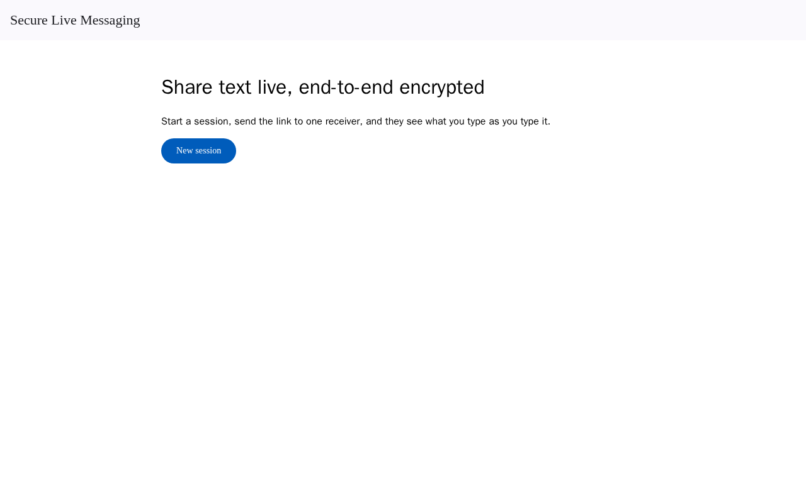
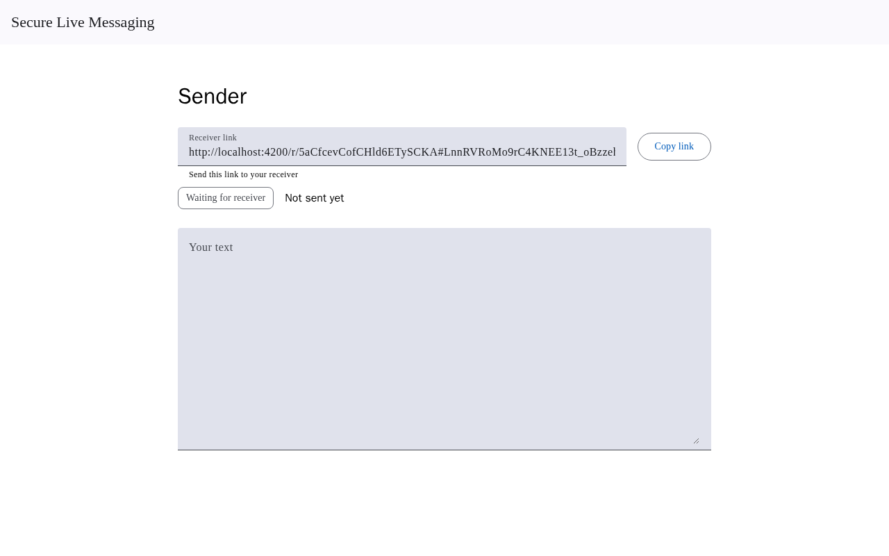
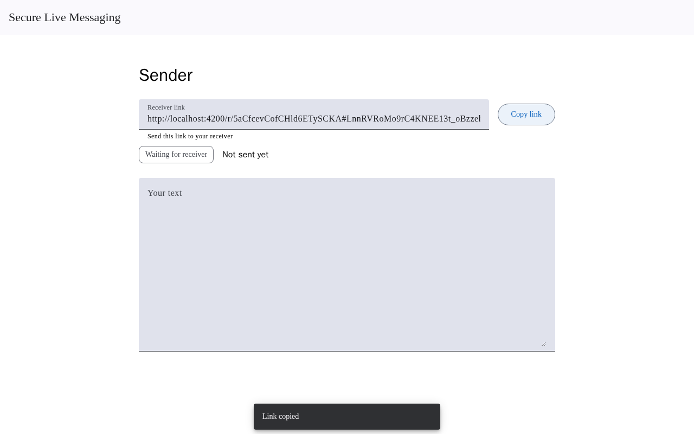
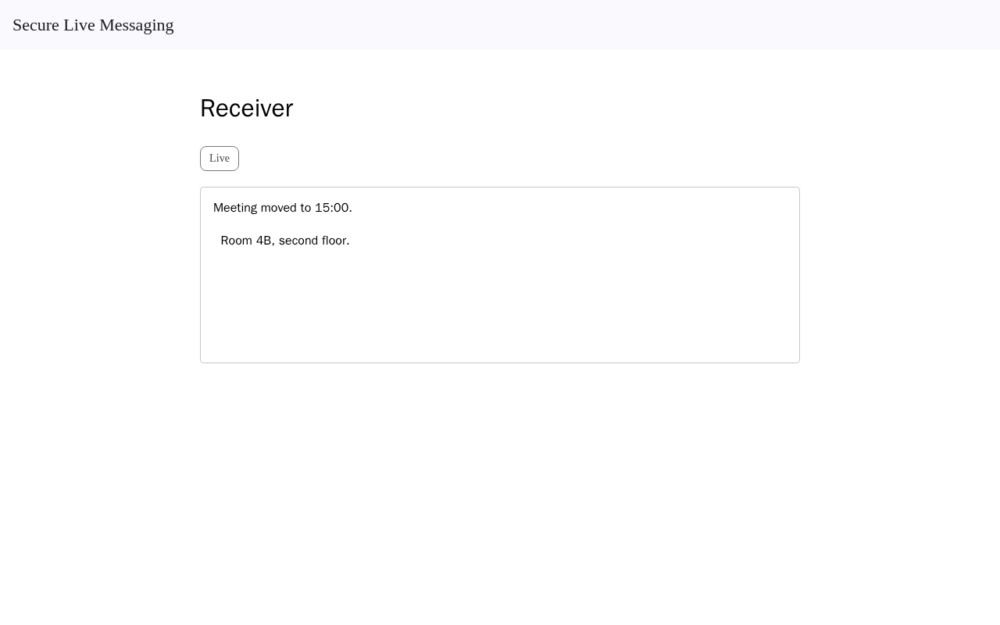
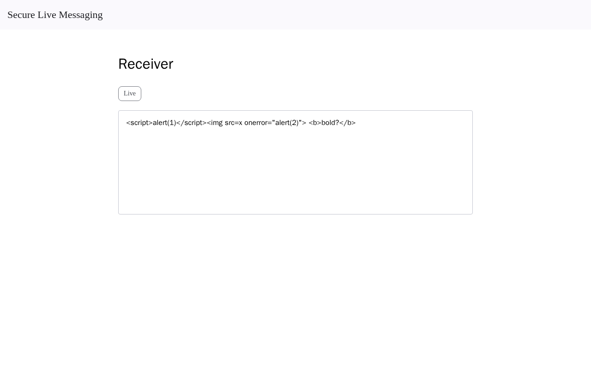
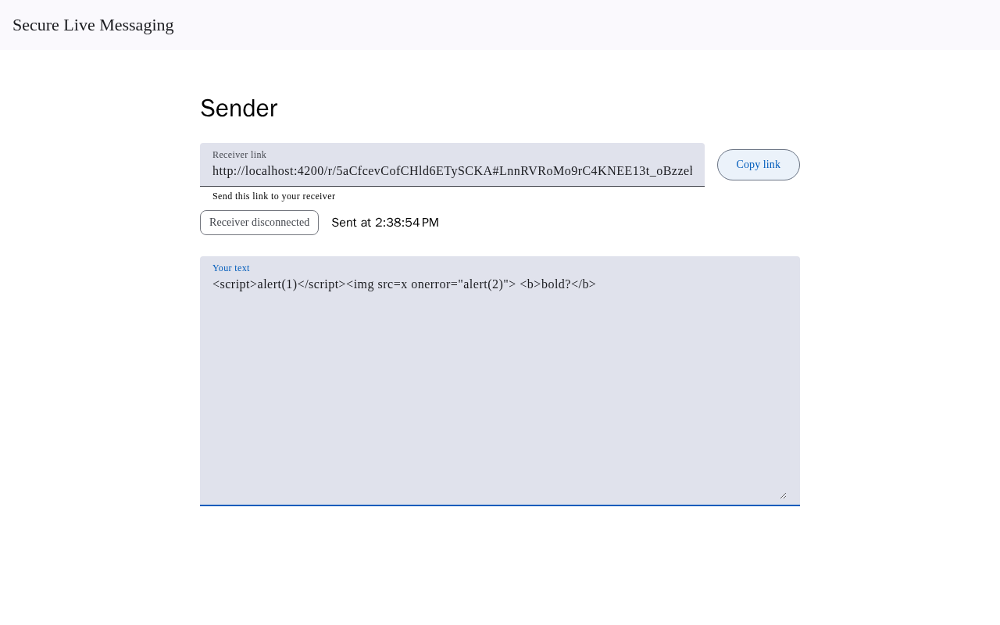
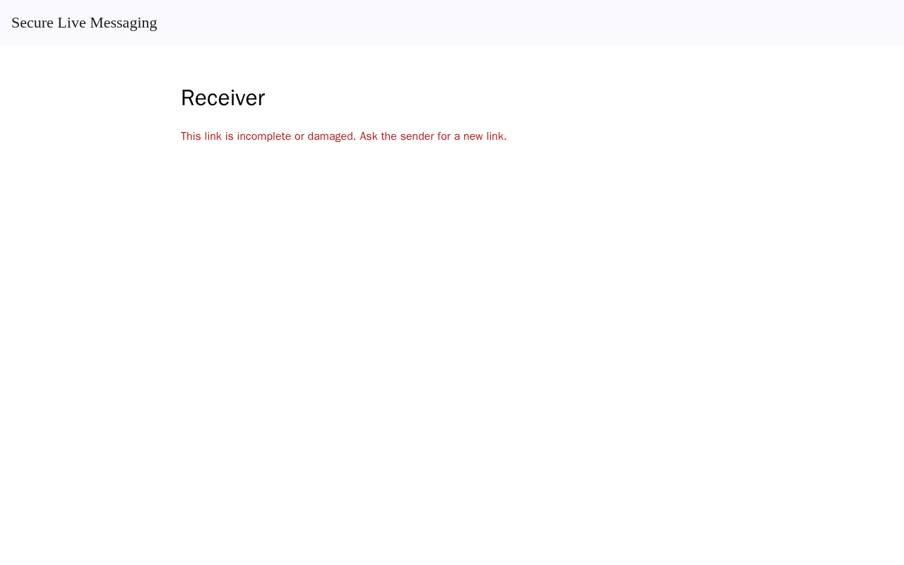
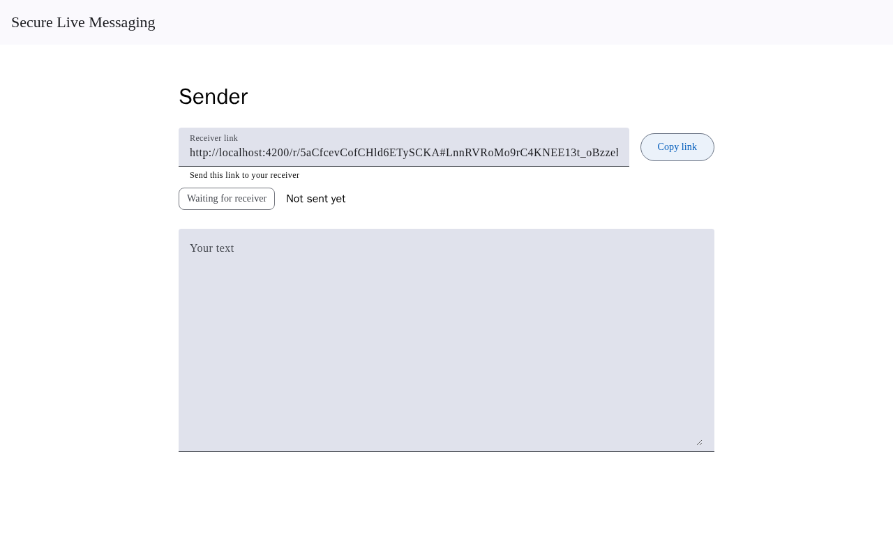
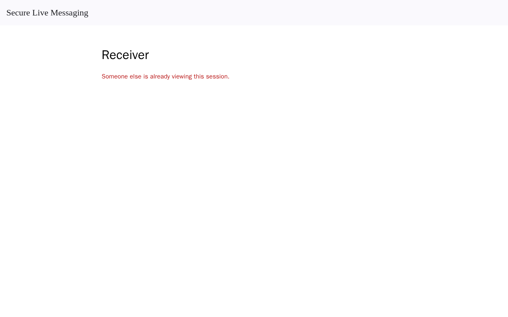
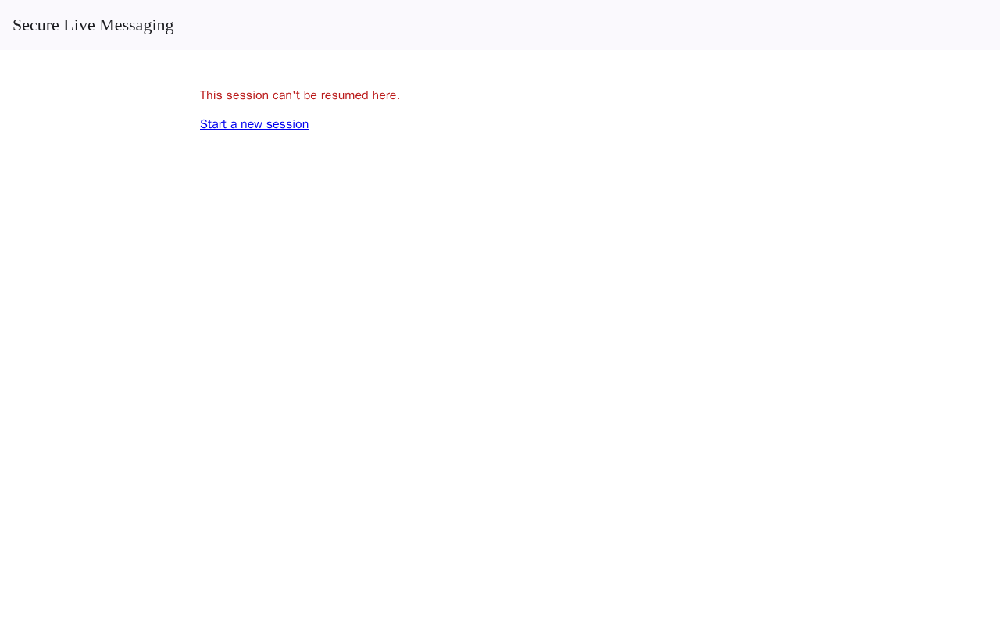

# Test guide: 06 Home, sender and receiver pages with Material, plain-text rendering and clear error states

## What this covers
The three routed pages: home, sender and receiver. It verifies the acceptance criteria of `docs/tasks/06-sender-receiver-ui.md`:
- "New session" leads to a working receiver link.
- Text appears live with line breaks kept.
- The editable fields are right: none on the receiver, exactly one on the sender.
- Markup is shown literally.
- The integrity banner works (component spec only).
- The key error appears while the sender keeps waiting.
- The peer chip and the last-sent time follow the session.
- Every element can be found by role and accessible name.

## Before you start
- Docker. The host may run any Node version; every command below runs in the Node 24 dev container (`.nvmrc`).
- Build the container once: `docker compose build dev`.
- Start the app with `docker compose --profile dev up dev`, which runs `npm run dev` in the Node 24 container. On a host with Node 24, `npm run dev` works too. Open `http://localhost:4200` in two different browsers, or in one normal and one private window. Each sender tab keeps its own session in sessionStorage.

## Automated tests
```sh
docker compose run --rm dev npm test
docker compose run --rm dev npm run typecheck
docker compose run --rm dev npm run build -w @slm/client
docker compose run --rm dev npm audit --omit=dev
```
Result:
- **Tests:** shared 262, server 113 and client 127, all passing.
- **Type check:** passes in all three workspaces.
- **Client build:** no budget warnings. The initial bundle is 272.47 kB raw, 74.80 kB transferred.
- **Audit:** 0 vulnerabilities.

The specs for this task are in `client/src/app/pages/`:

| Spec | Tests | What it covers |
|---|---|---|
| `page-view.spec.ts` | 10 | The pure labels and peer phase. |
| `receiver.page.spec.ts` | 11 | Real WebCrypto with a fake socket. |
| `sender.page.spec.ts` | 13 | The sender page; the clipboard is stubbed. |
| `home.page.spec.ts` | 2 | The home page. |
| `no-html-sinks.spec.ts` | 1 | No source file under `src/app` writes HTML into the DOM or bypasses the sanitiser. |

`sender-session.service.spec.ts` has 4 new tests for the `sending` and `connection` signals and the connect timeout.

`npm run e2e` passes with no tests. The Playwright tests come with task 07.

## Manual steps
The screenshots come from a headless Chromium run at 1280×800 against `npm run dev`. Each run used a new, throwaway localhost session.

1. Open `http://localhost:4200/no/such/route`.
   **Expected:** the address changes to `/` and the home page shows the "New session" button.
   
2. Click **New session**.
   **Expected:** the sender page opens.
   - The address is `/s/<session id>`, with no `#`.
   - The read-only **Receiver link** field holds `http://localhost:4200/r/<session id>#<key>`, with the hint "Send this link to your receiver".
   - The chip reads "Waiting for receiver" and the last-sent indicator reads "Not sent yet".
   - The only editable field on the page is **Your text**.
   
3. Click **Copy link**.
   **Expected:** a "Link copied" snackbar appears, and the clipboard holds exactly the link from the field. The snackbar never shows the key.
   
4. Open the copied link in the second browser.
   **Expected:**
   - The receiver shows "Waiting for the sender".
   - The sender's chip turns to "Receiver connected".
   
5. On the sender, type two lines with a blank line between them and leading spaces on the second, for example `Meeting moved to 15:00.`, an empty line, then `  Room 4B, second floor.`
   **Expected:**
   - After a short pause the receiver shows the same text without a reload, with the blank line and the leading spaces kept.
   - The receiver status reads "Live".
   - The receiver page has no input, textarea or other editable element.
   
   On the sender, the last-sent indicator switches to "Sent at" with the local time of the acknowledged publish.
   
6. Replace the sender text with `<script>alert(1)</script> <b>bold?</b>`.
   **Expected:**
   - The receiver shows those characters literally.
   - No dialog opens.
   - The text area contains no `script`, `img` or `b` element (checked in the run: 0 of each, 0 dialogs).
   
7. Close the receiver browser or tab.
   **Expected:** the sender's chip turns to "Receiver disconnected". The last-sent time stays.
   

## Failure cases
1. Damaged key. Open the receiver link with the last characters of the fragment replaced by `!!`, in a browser where no receiver is open yet.
   **Expected:** "This link is incomplete or damaged. Ask the sender for a new link." No text area is shown and the page never joins. A link with the fragment removed entirely gives the same message.
   
   The sender still reads "Waiting for receiver", because the receiver slot was not taken.
   
2. Second receiver. While a receiver is connected, open the same link in a third browser context.
   **Expected:** "Someone else is already viewing this session." with no text area.
   
3. Sender URL in another tab. Open the sender page's address (`/s/<session id>`) in a different browser.
   **Expected:** "This session can't be resumed here." with a "Start a new session" link, and no text input.
   

## Not covered
- **Integrity banner in a browser.** A real server only relays envelopes the sender encrypted, so a tampered or replayed update can't be produced from the UI. The component spec drives the real receiver service with a tampered envelope and with a replayed seq. It checks that the red "Integrity warning" banner appears, that the previous text stays exactly, and that the next valid update clears the banner. End-to-end coverage with a corrupted link comes in task 07.
- **A different but well-formed key.** If a fragment is still a valid 32-byte key but not the session's key, it imports without error. The receiver then joins, and every update shows the integrity banner instead of the key error. Only a fragment that doesn't decode to a 32-byte key gives the key error.
- **"Reconnecting…" on the sender and an unreachable server on home.** These are covered by the component and service specs, not by hand.
- **Sender join refusals:** unknown session, bad token and taken slot. The sender page spec covers these. A browser can't produce them without editing sessionStorage.
