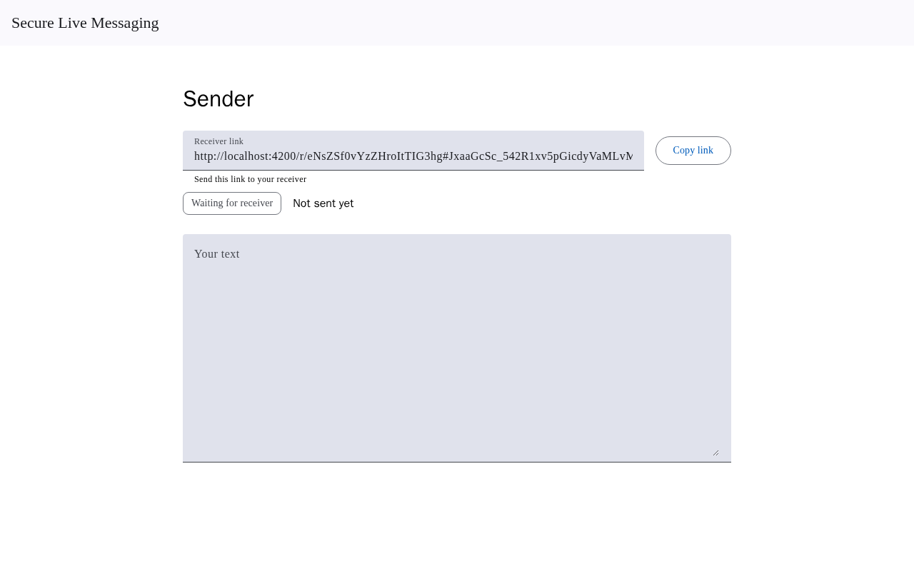
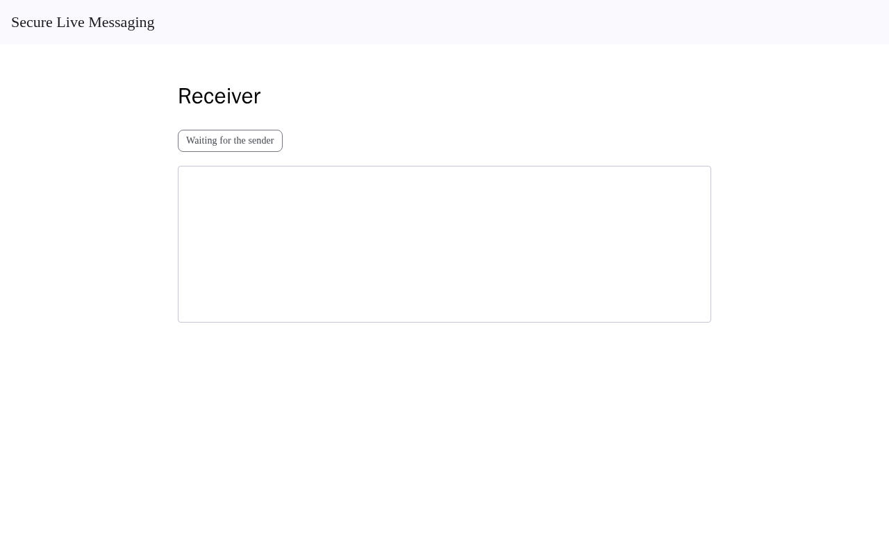
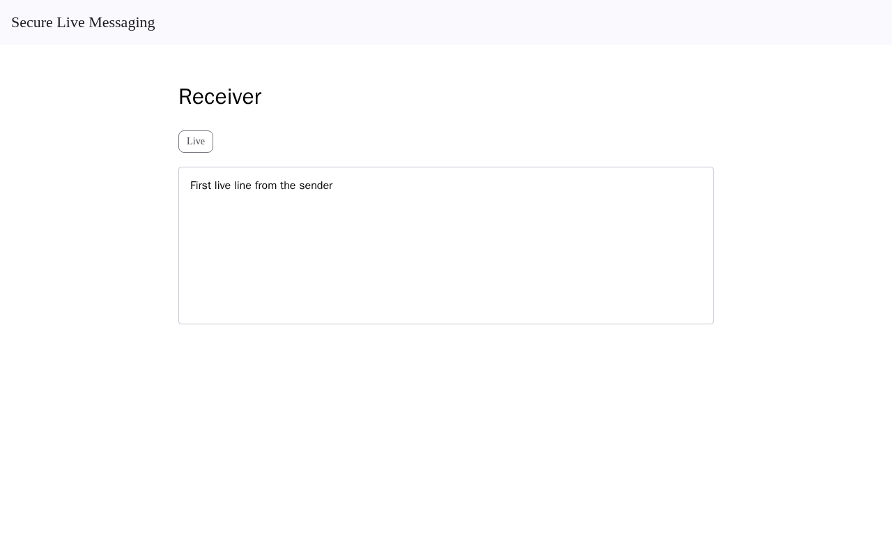
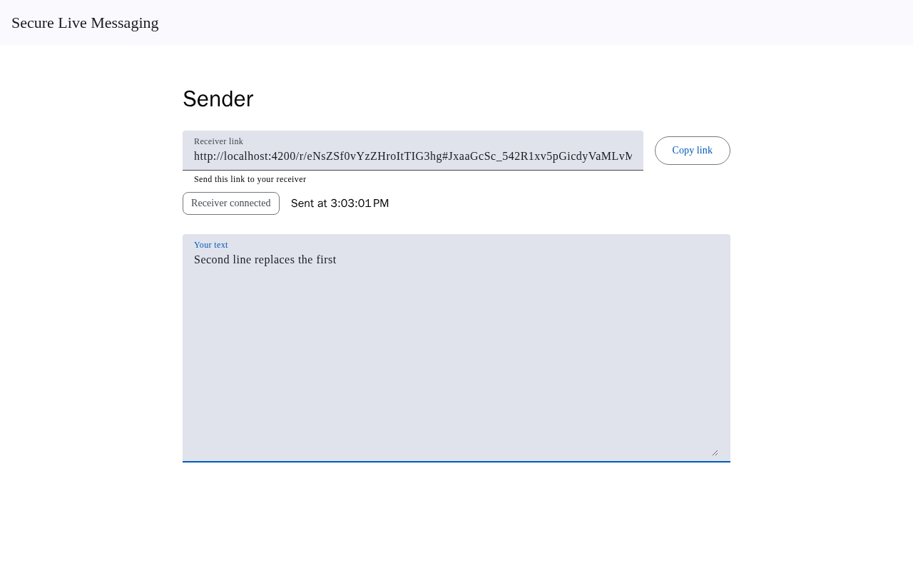
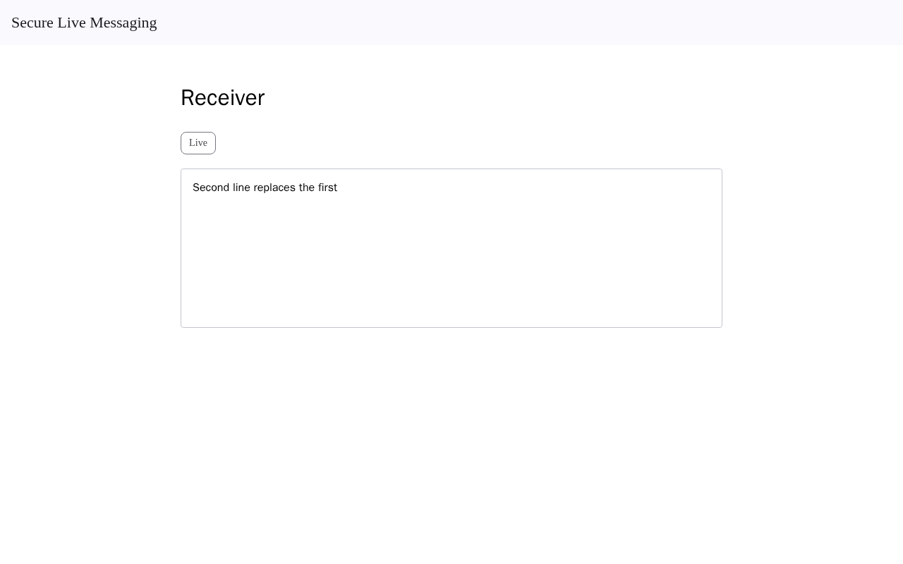
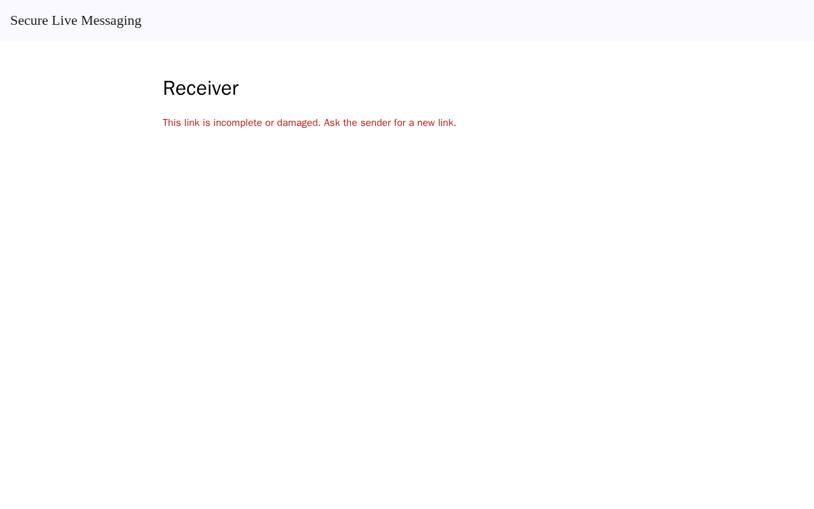
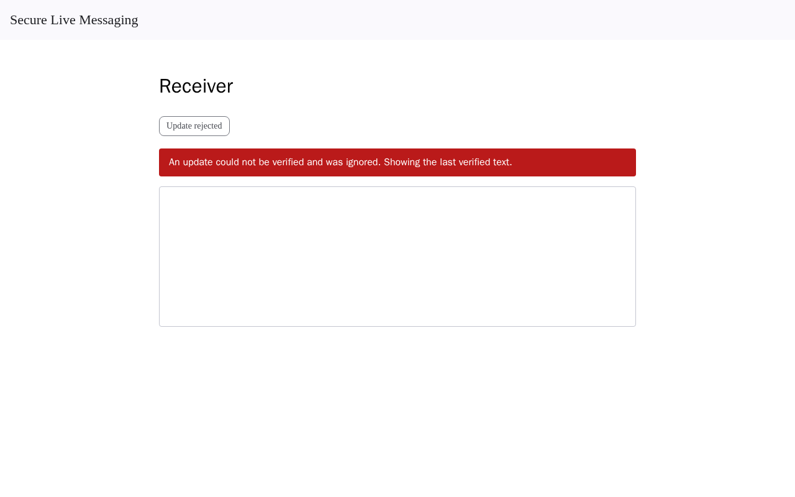

# Test guide: 07 Two-browser end-to-end tests

## What this covers
The Playwright suite drives a sender and a receiver in two separate Chromium contexts through the real app, which means the Angular pages, the dev proxy and the Socket.IO relay. It checks all six acceptance criteria:
- `npm run e2e` starts the stack on its own.
- Two consecutive updates replace each other on the receiver without a reload.
- A truncated key shows the invalid-key error.
- A wrong but well-formed key shows the integrity warning.
- Neither the key nor the plaintext appears in any request URL or outgoing WebSocket frame.
- The suite has no fixed waits and passes three runs in a row.

## Before you start
- Node 24 (`.nvmrc`). If your host runs another Node major, run every command through the dev container: `docker compose run --rm dev <command>`.
- `npm ci`. The dev container already ships the Playwright Chromium browser. On a host, run `npx playwright install chromium` once.
- No stack needs to be running. `npm run e2e` starts `npm run dev` itself and stops it afterwards. Locally, an already-running stack on :4200 is reused. With `CI` set, it never is.

## Automated tests
```
docker compose run --rm dev npm run e2e
docker compose run --rm dev npm test
docker compose run --rm dev npm run typecheck
```
Result:
- **`npm run e2e`:** 4 passed (about 6 s), three runs in a row, each from a container with no stack running.
  ```
  ✓ e2e/corrupted-key.spec.ts › a truncated key shows the invalid-key error and none of the sender text
  ✓ e2e/live-flow.spec.ts › the receiver shows two consecutive updates in order without a reload
  ✓ e2e/corrupted-key.spec.ts › a well-formed but wrong key shows the integrity warning and none of the sender text
  ✓ e2e/live-flow.spec.ts › neither browser sends the key or the plaintext in a request URL or a WebSocket frame
  4 passed (6.3s)
  ```
- **`npm test`:** shared 262, server 113 and client 127, all passing.
- **`npm run typecheck`:** passes in all workspaces.

The suite lives in `e2e/`:

| File | What it covers |
|---|---|
| `live-flow.spec.ts` | Two updates in order without a reload; no editable field on the receiver; the traffic check for the key and both plaintexts. |
| `corrupted-key.spec.ts` | Truncated key, and a wrong 32-byte key (every byte of the real key inverted). |
| `support/session.ts` | Start a session from home and read the link shown on the sender page, open a receiver, corrupt a key, record traffic and page errors. |
| `support/fixtures.ts` | One fresh browser context each for sender and receiver, closed after every test. |

## Manual steps
The screenshots come from a headless Chromium run at 1280×800 against `npm run dev`, using throwaway localhost sessions.

1. Open `http://localhost:4200`, click **New session**.
   **Expected:** the sender page shows the receiver link, "Waiting for receiver" and "Not sent yet".
   
2. Open the receiver link in a second browser profile or a private window.
   **Expected:** the receiver shows "Waiting for the sender" and an empty text area with no input. The sender's chip changes to "Receiver connected".
   
3. On the sender, type `First live line from the sender`.
   **Expected:** after a short pause the receiver shows the text and the status "Live".
   
4. Replace the sender's text with `Second line replaces the first`.
   **Expected:** the sender shows "Sent at …".
   
   The receiver shows only the second text, without reloading.
   

## Failure cases
1. Open the receiver link with the last five characters after `#` deleted.
   **Expected:** "This link is incomplete or damaged. Ask the sender for a new link." No status chip and none of the sender's text.
   
2. In a new session, type a text on the sender and wait for "Sent at …". Then open the receiver link with the first character after `#` changed to another letter (for example `A` to `B`).
   **Expected:** the receiver joins, shows "Update rejected" and the red integrity warning, and the text area stays empty.
   
   The suite inverts every byte of the key instead. The hand method in this step was also run once as a throwaway script, with the same result.

## Not covered
- **Firefox, WebKit and CI:** out of scope for this task; Chromium only.
- **Second receiver refused, sender reconnect, tampered ciphertext in transit:** out of scope here. Server integration tests (task 04) and client unit tests (task 05) cover them.
- **Plain-text rendering of markup (invariant 6):** not separately tested end to end, as the task says. The task 06 specs cover it.
- **What the server logs:** the suite checks what leaves the browsers, not the server's own output. Server log content is covered by the task 04 tests.
- **The e2e TypeScript in `npm run typecheck`:** the root has no typecheck script for `e2e/`. The files were checked once with `tsc` under the strict base config.
