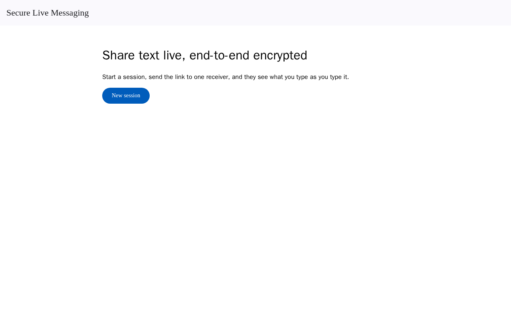
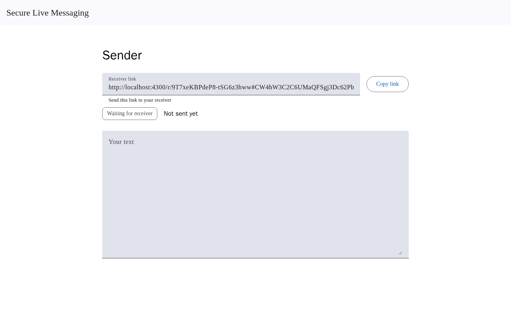
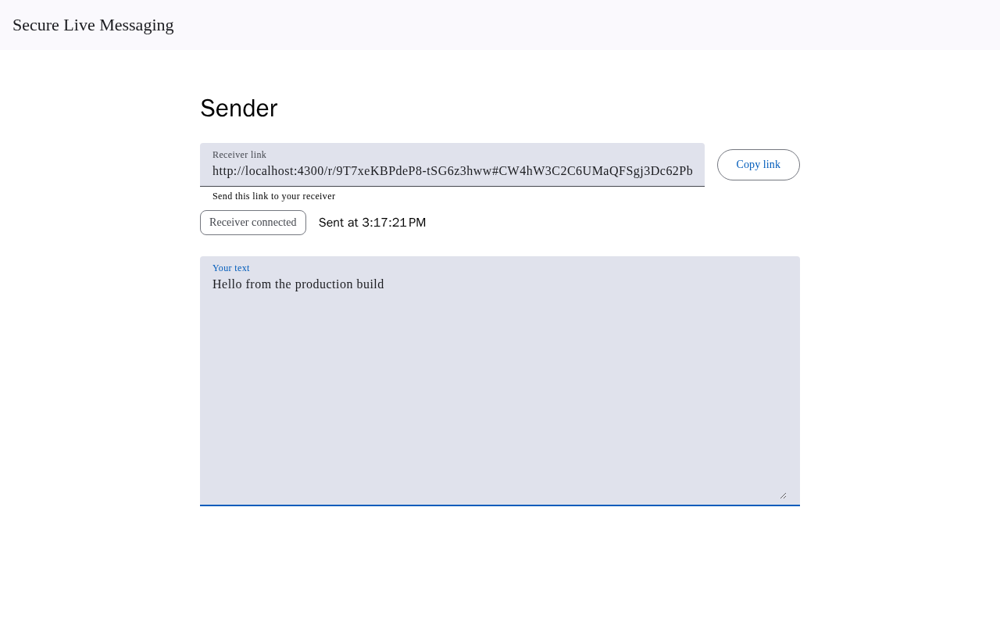
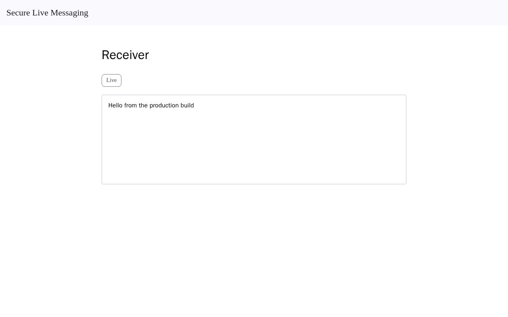

# Test guide: 08 Security headers on the built app, and the README

## What this covers
In production mode the Node server serves the built Angular app and the Socket.IO relay from one origin, and every response carries a strict Content Security Policy, `Referrer-Policy: no-referrer` and `X-Content-Type-Options: nosniff`, with `Cache-Control: no-store` on the index page. The Docker `app` service runs this mode. The README documents running, architecture, threat model, tests, limitations and AI usage.

It verifies these acceptance criteria:
- The production start script serves app and relay from one origin, and `/r/<id>#<key>` loads directly.
- The headers are on the index page, static assets and fallback routes, checked in `npm test`.
- The full flow works under the CSP with no violations.
- No fonts, icons or scripts load from another host.
- The README has the required sections, describes the product only, and its commands work on a fresh clone.

## Before you start
- Node 24 (`.nvmrc`). If your host runs another Node major, run every command through the dev container: `docker compose run --rm dev <command>`.
- `npm ci`. On a host, run `npx playwright install chromium` once; the dev container ships Chromium.
- Production mode: `npm start` builds the client and serves it on `http://localhost:3000`.
- Docker only: `docker compose up --build` serves it on `http://localhost:4200` (`CLIENT_PORT` changes the host port).

## Automated tests
```
docker compose run --rm dev npm test
docker compose run --rm dev npm run typecheck
docker compose run --rm dev sh -c "CI=1 npm run e2e"
```
Result:
- **`npm test`:** shared 262, server 146 and client 134, all passing. The new server tests:
  - `server/src/static-site.test.ts` (16): exact header values; `script-src 'self'` with no `unsafe-inline` or `unsafe-eval`; `connect-src` and `frame-ancestors`; routing, including the fallback, traversal-style paths and refused methods; per-response headers; content types.
  - `server/src/static-server.test.ts` (12): the real server on a random port against a fixture build. The index page, a script asset and the `/r/` and `/s/` fallbacks return the exact headers; HEAD has no body; POST gets 405 with the headers; a traversal path gets the index page; a WebSocket from the page origin connects on the same server; long-polling is still refused; a missing build or index page fails to load.
  - `server/src/config.test.ts`: `HOST` is read, trimmed, and defaults to `127.0.0.1`; production mode is on with `--production` or `NODE_ENV=production`, and off otherwise.
  - `client/src/index-html.spec.ts`: the production index has no `<base>` element and only absolute asset paths; the dev index differs from it only by the `<base>` line.
- **`npm run typecheck`:** passes in all workspaces.
- **`npm run e2e`:** 5 passed (7.6 s). It builds the client, then runs the four existing tests against the dev stack on :4200 and the new `e2e/production-csp.spec.ts` against the production server on :4300:
  ```
  ✓ [production] › e2e/production-csp.spec.ts › the sender-to-receiver flow works on the production build with no CSP violation and no other host
  5 passed (7.6s)
  ```
  The production test opens the receiver link directly, asserts the headers on that navigation, waits for the text, and checks that neither browser recorded a CSP violation (`securitypolicyviolation` events and console errors) and that every request went to the page's own host.

## Manual steps
1. Start the production server: `npm start` (or, without Node, `docker compose up --build`). Open `http://localhost:3000` (Docker: `http://localhost:4200`).
   **Expected:** the home page with the "New session" button. The server log shows `server_listening port=3000 static=on`.
   

2. Click **New session**.
   **Expected:** the sender page shows the receiver link, on the same origin as the page.
   

3. Copy the link and open it directly in a second browser window, then type into the sender's text box.
   **Expected:** the sender shows "Receiver connected" and "Sent at …".
   

4. Look at the receiver window.
   **Expected:** the typed text and the "Live" status. Opening DevTools → Console shows no Content Security Policy errors in either window.
   

5. Check the headers on a receiver route (this run used the Docker app on `CLIENT_PORT=4321`, from a fresh clone):
   ```
   curl -sI http://localhost:4321/r/abcdefghijklmnopqrstuv
   ```
   **Expected and observed:**
   ```
   HTTP/1.1 200 OK
   Content-Security-Policy: default-src 'none'; script-src 'self'; style-src 'self' 'unsafe-inline'; connect-src 'self'; img-src 'self' data:; font-src 'self'; base-uri 'none'; form-action 'none'; frame-ancestors 'none'; object-src 'none'
   Referrer-Policy: no-referrer
   X-Content-Type-Options: nosniff
   Cache-Control: no-store
   Content-Type: text/html; charset=utf-8
   Content-Length: 471
   ```
   A built script asset (`curl -sI http://localhost:4321/main-<hash>.js`, name from the page source) returns the same three security headers with `Content-Type: text/javascript; charset=utf-8` and no `Cache-Control`.

6. Fresh clone check of the README commands. In a new clone, these ran as written:
   - `docker compose up --build` (with `CLIENT_PORT=4321`): the headers above; log `server_listening port=3000 static=on`.
   - `docker compose build dev`, then in the dev container `npm ci`, `npm test` (262 + 143 + 134 passed), `npm run typecheck` (passes), and `PORT=3400 npm start`: log `server_listening port=3400 static=on`; `GET /s/x` returned 200 with the CSP and `no-store`.

## Failure cases
1. A method other than GET or HEAD:
   ```
   curl -sI -X POST http://localhost:4321/
   ```
   **Observed:** `HTTP/1.1 405 Method Not Allowed`, with `Allow: GET, HEAD`, `Cache-Control: no-store` and the three security headers.

2. An unknown asset path: `curl -sI http://localhost:4321/missing-ABC.js`
   **Observed:** 200 with `Content-Type: text/html; charset=utf-8`, the index page. `nosniff` keeps a browser from running it as a script.

3. A traversal path: `curl -sI --path-as-is http://localhost:4321/../../package.json`
   **Observed:** 200 with `text/html`, the index page. Only files loaded from the build at startup can be served.

4. A long-polling handshake: `curl -s "http://localhost:4321/socket.io/?EIO=4&transport=polling"`
   **Observed:** `{"code":0,"message":"Transport unknown"}` with status 400.

5. Starting production mode without a build (`npx tsx src/main.ts --production` in `server/` with no `client/dist`):
   **Observed:** the log line `server_start_failed missing_client_build` and exit code 1. Covered by the `loadStaticSite` tests.

6. The CSP check itself can fail. With an inline `<script>` planted in the built `index.html`, the production e2e test failed with `["script-src-elem inline"]`; with `'unsafe-inline'` removed from `style-src`, it failed on the exact-policy assertion. Both were reverted.

## Not covered
- Browsers other than Chromium. Older browsers may not treat `connect-src 'self'` as covering a same-origin WebSocket.
- Windows and macOS hosts: the npm scripts use no shell syntax, but the runs above were on Linux only (the dev container).
- HTTPS and HSTS: the app does not terminate TLS; that is left to a reverse proxy.
- Security headers in development mode: the Angular dev server is not hardened.
