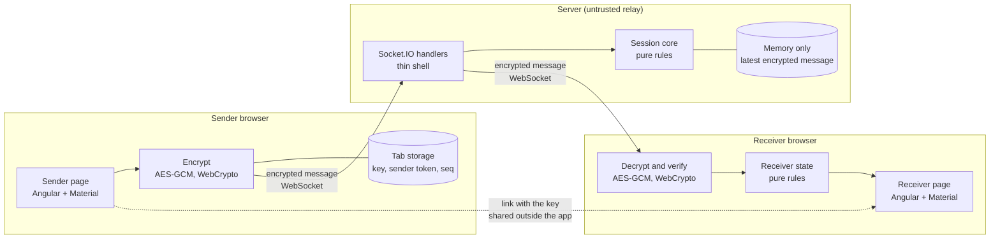
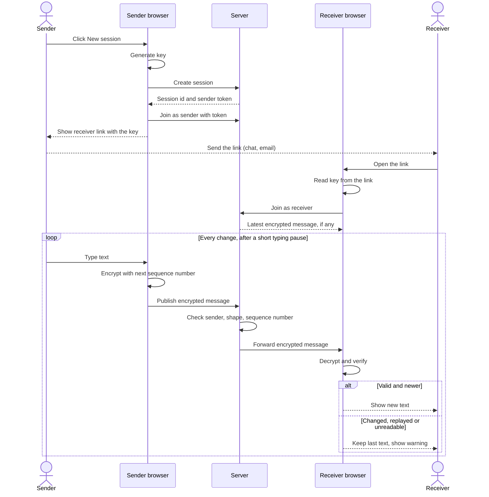
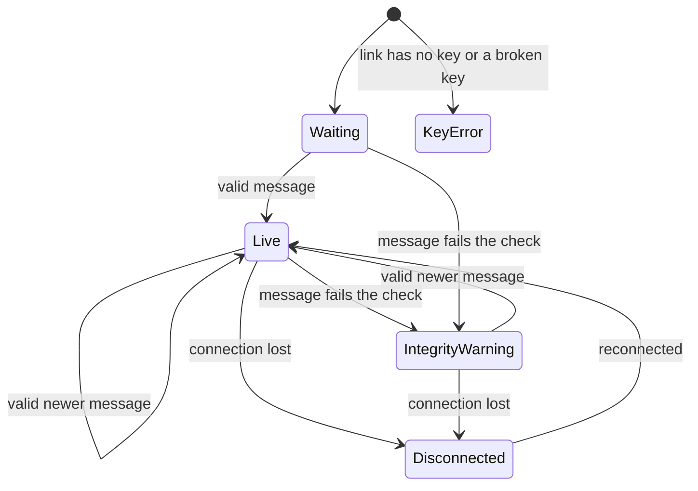

# Project summary

## What it is

Secure Live Messaging is a small web app. A **sender** types into a text input, and one **receiver** sees that text displayed and updated live through a unique link.

The sender copies the link and passes it to the receiver on another platform, such as chat or email. The app never sends the link itself.

The text is encrypted in the sender's browser and decrypted in the receiver's browser. The server in between only passes encrypted data along. It never has the key or the readable text.

Two things define the scope:

- **One direction only.** Text flows from the sender to the receiver. The receiver can only read; it can't type, reply or send anything back.
- **Two participants only.** A session has exactly one sender and one receiver. A third visitor who opens the same link is refused.

## The main idea

- The encryption key is created in the sender's browser.
- The key travels to the receiver inside the link, in the part after `#`. Browsers never send that part to a server.
- The server sees only encrypted messages, so it can relay them but can't read them.
- If anyone changes a message on the way, the receiver's browser notices, ignores it and shows a warning. It keeps the last good text on screen.

## Architecture

The arrows for encrypted messages point one way, from sender to receiver. The only thing the sender learns about the receiver is whether it is connected.

The code is split into three packages:

| Package | What it holds |
|---|---|
| `shared/` | Encryption and decryption, message types and message validation. Used by both sides, so they can't drift apart. |
| `server/` | The relay: session rules as a pure function, with thin Socket.IO handlers around it. |
| `client/` | The Angular app: home, sender and receiver pages. |

## Workflow

## What the receiver shows

In the warning state the last good text stays on screen. In the key error state the receiver never joins and shows no text.

## Security rules in short

1. The key and the readable text never reach the server.
2. The receiver shows text only if it decrypts correctly **and** is newer than the last text shown.
3. Only the sender can publish, so text flows one way. The server gives the sender a secret token when the session is created, and it never goes into a link. A publish attempt from the receiver is refused.
4. A session has exactly one sender and one receiver. Extra visitors are refused.
5. The server checks the shape and size of every message and never trusts what a client says about its role.
6. Text is shown as plain text, never as HTML.
7. A failed decryption never breaks the page and never shows partial text.

## Tech stack

| Area | Choice |
|---|---|
| Frontend | Angular 21 (LTS) + Angular Material |
| Backend | Node 24 + TypeScript + Socket.IO, WebSocket only |
| Encryption | AES-GCM-256 through the browser's WebCrypto API |
| Storage | None. The server keeps sessions in memory only. |
| Tests | Vitest (unit and integration), Playwright (two browsers end to end) |
| Repo | npm workspaces: `shared/`, `server/`, `client/` |

## Known limitations

- The key ends up in browser history and wherever the link is pasted.
- The server operator can see when messages are sent, how big they are, and IP addresses.
- A malicious server could serve changed JavaScript that leaks the key.
- A server restart ends all sessions.

## Build plan

Nine tasks, about 275 minutes of work (about 205 minutes elapsed if the server and client tasks run side by side).

| Step | Task |
|---|---|
| 1 | 00 Project setup |
| 2 | 01 Encryption |
| 3 | 02 Message types and validation |
| 4a | 03 Session rules, then 04 Socket.IO server |
| 4b | 05 Client services, then 06 Pages |
| 5 | 07 End-to-end tests |
| 6 | 08 Security headers and README |

Steps 4a and 4b can run in parallel.

## Where to read more

- `docs/architecture-decisions.md`: each decision with its reasoning.
- `docs/implementation-plan.md`: the protocol and message format.
- `docs/tasks/`: one file per task, plus the schedule.
